# VPN-GW: посібник адміністратора панелі

**VPN-GW 0.10.9 · 22.11.2026** · Для адміністраторів, які обслуговують портал. Встановлення сервера описано в `QUICKSTART.md` і `INSTALL_GUIDE.md`, будова коду — у `DEVELOPMENT.md`.

Панель адміністратора дає змогу без командного рядка:
- налаштовувати підключення до MikroTik, пошти й Active Directory і перевіряти їх кнопкою;
- вибирати, куди і що писати в журнал, і переглядати журнал;
- створювати й завантажувати резервні копії;
- оновлювати портал завантаженням архіву нової версії.

**Як влаштовано сторінку** (оформлення як у ITSM System): угорі — темне меню розділів (Огляд, Автентифікатори, MikroTik, Пошта, Active Directory, Журнали, Резервні копії, Оновлення), праворуч — ваш логін і «Вийти». У розділах «Журнали» і «Резервні копії» під меню є вкладки: «Журнал аудиту» / «Налаштування журналів» і «Резервні копії» / «Розклад і пароль». Налаштування згруповано в картки; біля кожного поля праворуч — назва параметра і звідки взято значення («типове», «з .env» або позначка «змінено в панелі»).

---

## 1. Вхід

**Адреса:** `https://vpn-gw.company.ua/<APP_BASE_PATH>/admin`. Шлях `APP_BASE_PATH` той самий, що й у порталу; його видно в `/srv/vpn-gw/.env`.

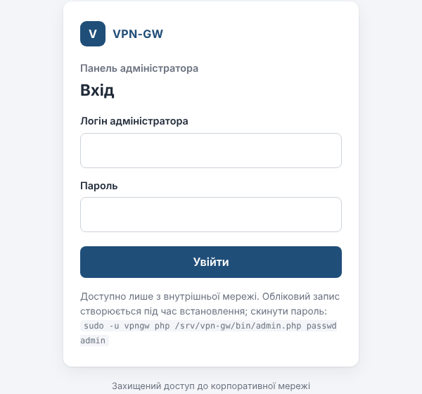

| Правило | Пояснення |
|---|---|
| Лише з внутрішньої мережі | Панель відкривається тільки з підмереж `INTERNAL_NETWORKS` у `.env`. З Інтернету будь-яка адреса `/admin…` повертає 404, ніби її не існує |
| Локальні облікові записи | Адміністратори панелі не залежать від AD: панель працює, навіть коли налаштування AD хибні. Пароль — мінімум 12 символів, зберігається як хеш Argon2id |
| Ліміт спроб | 5 невдалих входів з однієї адреси або для одного логіна блокують вхід на `LOCKOUT_SECONDS` (типово 15 хв) |
| Сесія | Прив'язана до IP-адреси. Завершується після 30 хв бездіяльності, але не пізніше ніж через 8 год |

Перший обліковий запис (`admin`) створює `install.sh`. Інші — з командного рядка сервера:

```bash
sudo -u vpngw php /srv/vpn-gw/bin/admin.php list              # перелік
sudo -u vpngw php /srv/vpn-gw/bin/admin.php create petrenko   # новий адміністратор (пароль запитується)
sudo -u vpngw php /srv/vpn-gw/bin/admin.php passwd admin      # новий пароль, якщо забули
sudo -u vpngw php /srv/vpn-gw/bin/admin.php delete petrenko   # видалити
```
Свій пароль можна змінити в панелі: клацніть свій логін праворуч у верхньому меню.

---

## 2. Огляд

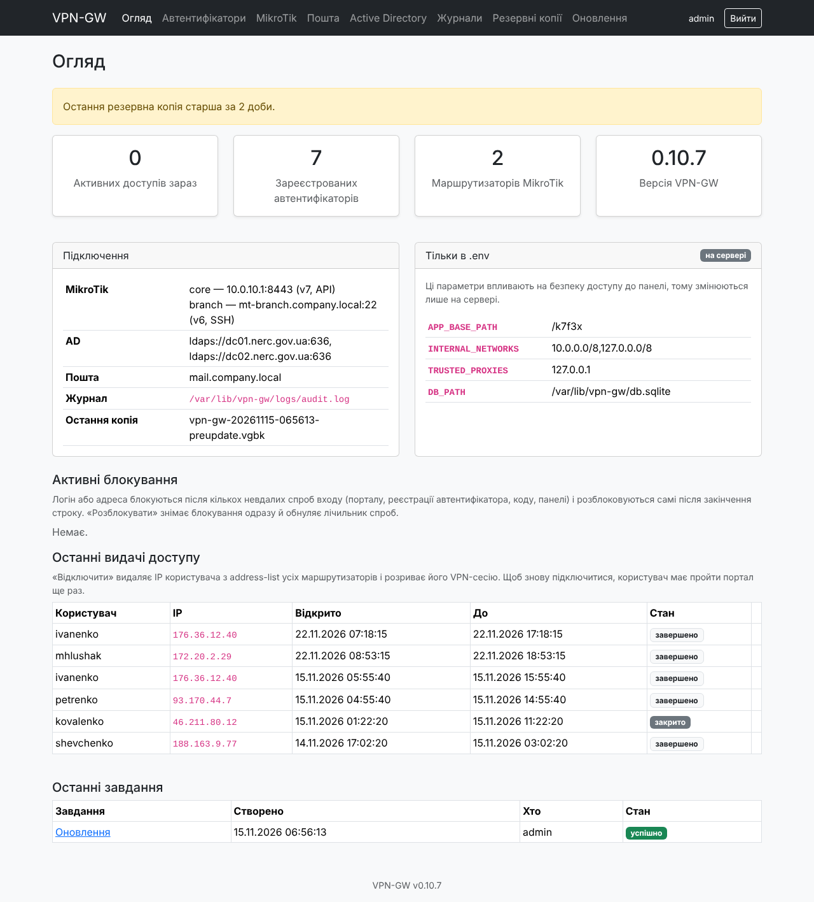

Попередження вгорі також з'являються, якщо AD підключено без перевірки сертифіката або без шифрування, і якщо для SSH-маршрутизатора не підтверджено ключ хоста.

**Плитки** (клік по плитці відкриває відповідний розділ):
- кількість активних доступів → таблиця «Останні видачі доступу» нижче на цій сторінці;
- кількість зареєстрованих автентифікаторів → сторінка «Автентифікатори» (2.2);
- кількість активних маршрутизаторів (і скільки відключено) → «Підключення до MikroTik» (4);
- версія VPN-GW → «Оновлення» (9).

**Нижче:**
- поточні підключення: MikroTik, AD, пошта, файл журналу, остання резервна копія;
- параметри, які змінюються лише в `.env`;
- активні блокування — з кнопкою **«Розблокувати»** (див. 2.3);
- останні видачі доступу — з кнопкою **«Відключити»** (див. 2.1);
- останні завдання (резервні копії, оновлення).

Дати й час у панелі показуються у форматі `22.11.2026 09:06:47` (часовий пояс сервера, типово Europe/Kyiv).

Попередження вгорі з'являються, якщо:
- не задано пароль резервних копій;
- вимкнено пошту;
- остання копія старша за дві доби.


### 2.1. Відключення користувача

У таблиці «Останні видачі доступу» біля кожного **активного** доступу є кнопка **«Відключити»**. Вона робить те саме, що кнопка «Відкликати доступ» на сторінці користувача:
- видаляє IP користувача з address-list на всіх маршрутизаторах (у списку кожного маршрутизатора);
- розриває його VPN-сесію (PPP і IPsec);
- позначає доступ як «закрито».

Щоб підключитися знову, користувач має ще раз пройти портал (пароль AD і код). Якщо треба не допустити повторного входу, вимкніть обліковий запис в AD або вилучіть його з групи VPN.

Підтвердження перед відключенням немає (у панелі немає JavaScript). Якщо якийсь маршрутизатор не відповів, панель повідомить про це; подробиці — у журналі (`mt_error`). У журнал записується подія `admin_revoke` (хто відключив, кого і з якої IP).


### 2.2. Зареєстровані автентифікатори

Меню **«Автентифікатори»** — окрема сторінка зі списком користувачів, які прив'язали Microsoft Authenticator до VPN-GW.

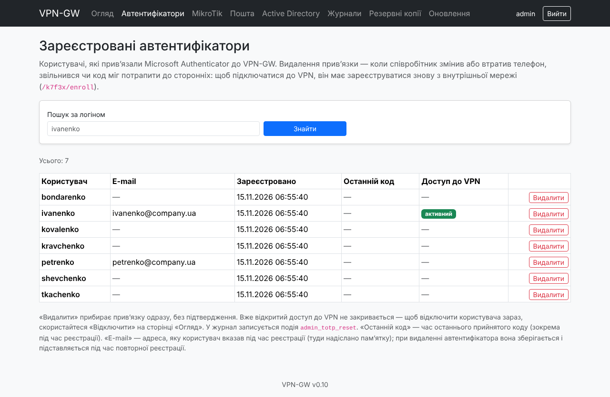

| Колонка | Що означає |
|---|---|
| Користувач | Доменний логін |
| E-mail | Адреса, яку користувач вказав під час реєстрації (туди надіслано пам'ятку); при видаленні автентифікатора зберігається і підставляється під час повторної реєстрації |
| Зареєстровано | Коли прив'язано автентифікатор |
| Останній код | Коли востаннє прийнято код з цього автентифікатора (зокрема під час реєстрації) |
| Доступ до VPN | «активний», якщо зараз відкрито доступ |

Над таблицею — пошук за логіном.

**Видалити** прибирає прив'язку одразу, без підтвердження (так само, як `bin/totp-reset.php`). Коли це потрібно:
- співробітник змінив або втратив телефон;
- співробітник звільнився;
- код чи QR-код міг потрапити до сторонніх.

Після видалення користувач не зможе пройти другий крок входу, доки не зареєструється знову з внутрішньої мережі (`<APP_BASE_PATH>/enroll`). Вже відкритий доступ до VPN видалення **не** закриває: щоб відключити користувача зараз, натисніть «Відключити» на сторінці «Огляд» (2.1). У журнал записується подія `admin_totp_reset` (хто видалив і чию прив'язку).


### 2.3. Активні блокування

Після кількох невдалих спроб портал тимчасово блокує логін або IP-адресу, і користувач бачить «Забагато спроб. Спробуйте пізніше.». Блокування знімається саме через `LOCKOUT_SECONDS` (типово 15 хв). Ліміти задаються в `.env`:

| Що блокується | Коли | Параметр |
|---|---|---|
| Логін | 3 невдалі паролі AD за 15 хв — на сторінці входу або реєстрації автентифікатора | `RATE_LOGIN_USER=3/900` |
| IP-адреса | 5 невдалих спроб входу з однієї адреси за 15 хв | `RATE_LOGIN_IP=5/900` |
| Логін і адреса | вичерпано спроби введення коду (`RATE_MFA_ATTEMPTS`) | — |
| Логін / адреса адміністратора | невдалі паролі входу до панелі | ті самі |

На сторінці «Огляд» таблиця **«Активні блокування»** показує: що заблоковано (логін чи IP-адреса), значення, де сталися невдалі спроби (вхід на портал, реєстрація автентифікатора, код підтвердження, вхід до панелі) і до якого часу діє блокування. Блокування, що вже минули, не показуються.

**«Розблокувати»** знімає блокування одразу й обнуляє лічильник невдалих спроб (для логіна — і лічильник кодів на e-mail), так само як `bin/unlock.php`. Підтвердження немає. У журнал записується подія `unlock` (хто розблокував і що).

Перш ніж розблокувати, перевірте в «Журналах» події `login_fail` / `enroll_fail` для цього логіна чи адреси: багато невдалих спроб з різних адрес або під різними логінами — ознака підбору пароля, а не помилки користувача.

---

## 3. Як працюють налаштування

- Значення з панелі мають **пріоритет** над `.env`. Біля кожного поля видно назву параметра і джерело: «з .env», «змінено в панелі» або «типове».
- **Перед збереженням перевіряється вся конфігурація.** Якщо значення хибне, з'являється «Не збережено: …», а попереднє значення залишається. Портал продовжує працювати.
- **Паролі** (MikroTik, SMTP, резервні копії) зберігаються зашифрованими і в браузер не повертаються. Щоб залишити пароль без змін, не заповнюйте поле. Щоб видалити — позначте «очистити».
- Поле, змінене в панелі, має посилання **«повернути значення з .env»**.
- Нові значення діють з наступного запиту. Перезапускати нічого не потрібно.
- Кожне збереження записується в журнал (подія `admin_settings_saved`): хто зберіг і які параметри змінено, без значень.

Деякі параметри змінюються **лише в `.env`**: від них залежить доступ до самої панелі або захист порталу. Це `APP_BASE_PATH`, `APP_KEY`, `INTERNAL_NETWORKS`, `TRUSTED_PROXIES`, ліміти `RATE_*`, `LOCKOUT_SECONDS` і шляхи до бази. Після зміни `.env` запустіть `install.sh --yes`.

**Аварійне скидання.** Якщо значення з панелі пройшло перевірку, але заважає порталу працювати в цьому середовищі:
```bash
sudo -u vpngw php /srv/vpn-gw/bin/settings.php list           # чинні значення і джерело
sudo -u vpngw php /srv/vpn-gw/bin/settings.php reset SMTP_HOST
```

---

## 4. MikroTik

Для кожного маршрутизатора можна вибрати свій протокол:

| Протокол | Як працює | Що потрібно на маршрутизаторі |
|---|---|---|
| **API** | RouterOS 7 — REST через `www-ssl`, RouterOS 6 — API-SSL; TLS з перевіркою сертифіката корпоративного CA | Сертифікат з IP або DNS-ім'ям у SAN; `deploy/mikrotik/routeros7.rsc` / `routeros6.rsc` |
| **SSH** | Консольні команди RouterOS через SSH (версії 6 і 7); перевіряється ключ хоста маршрутизатора | Сервіс `ssh`, користувач з policy `ssh,read,write`, пароль або ключ; `deploy/mikrotik/routeros-ssh.rsc` |

Сторінка **«Підключення до MikroTik»** складається з трьох частин:
1. **Картки маршрутизаторів** — лише перегляд: назва, адреса (IP / DNS), версія RouterOS, протокол підключення і **address-list**, у який портал додає IP на цьому маршрутизаторі (жирним; позначка «типовий» — використовується `MT_LIST`); для SSH — стан ключа хоста. Активний маршрутизатор — **світло-зелена** картка з позначкою «активний», відключений — **сіра** з позначкою «відключено». Кнопки на картці:
   - **«Редагувати»** — сторінка цього маршрутизатора (4.0);
   - **«Відключити»** / **«Включити»** — тимчасово вивести маршрутизатор з роботи або повернути (4.6);
   - **«Видалити»** — прибрати маршрутизатор з налаштувань разом з його паролем і ключем SSH.

   Картка **«+ Додати маршрутизатор»** — сторінка нового маршрутизатора.
2. **Таблиця «Підключені маршрутизатори»** — усі маршрутизатори зі станом (відключені — сірим рядком) і кнопкою «Видалити».
3. **Основні параметри** — спільні для всіх маршрутизаторів: тривалість доступу і дозволені приватні мережі клієнтів.

| Поле | Що вказати |
|---|---|
| Тривалість доступу | `ГГ:ХХ:СС`; після цього MikroTik сам видаляє адресу |
| Дозволені приватні мережі клієнтів | Через кому, наприклад `172.20.2.0/23`. Типово портал приймає лише публічні IP (вхід з приватної адреси — `login_fail reason=bad_ip`). Додайте мережу, якщо співробітники підключаються до VPN з внутрішньої мережі або для тестування з офісу |


**Задаються лише в `.env`** (на сторінці не показуються; діють, якщо задані в `.env` або були збережені в панелі попередніми версіями):
- `MT_LIST` — типовий address-list (типово `Allowed_VPN_Users`) для маршрутизаторів, у яких не вибрано власний;
- `MT_CA_FILE` — PEM-файл CA у `/etc/ssl/`, яким перевіряється сертифікат маршрутизаторів з протоколом API (для лише SSH-маршрутизаторів не потрібен);
- типові облікові дані `MT_USER`, `MT_PASS`, `MT_SSH_USER`, `MT_SSH_PASS` — для маршрутизатора без власного користувача чи пароля;
- спільний приватний ключ SSH `MT_SSH_KEY`, `MT_SSH_KEY_PASS` — SSH-маршрутизатор спершу пробує його.

Після зміни `.env` запустіть `install.sh --yes`. Значення, збережене раніше в панелі, має пріоритет над `.env` — щоб діяло значення з `.env`, виконайте `sudo -u vpngw php /srv/vpn-gw/bin/settings.php reset <КЛЮЧ>`. Рекомендовано задавати користувача й пароль на сторінці кожного маршрутизатора. Подивитися чинні значення: `sudo -u vpngw php /srv/vpn-gw/bin/settings.php list`.

### 4.0. Сторінка маршрутизатора

**«Редагувати»** на картці (або **«+ Додати маршрутизатор»**) відкриває сторінку з усіма параметрами підключення цього маршрутизатора:

| Блок | Поля |
|---|---|
| Підключення | Назва (латиниця, цифри, `_` `-`; показується в журналі), адреса (IP або DNS-ім'я), версія RouterOS, протокол (API — REST для RouterOS 7 / API-SSL для RouterOS 6; або SSH), порт (REST — 443/8443, API-SSL — 8729, SSH — 22) |
| Обліковий запис на маршрутизаторі | Користувач і пароль (4.1) |
| Address-list | Список цього маршрутизатора; кнопка «Вибрати з MikroTik» (4.4) |
| Ключ хоста SSH | Лише для SSH: відбиток і «скинути ключ» (4.2) |

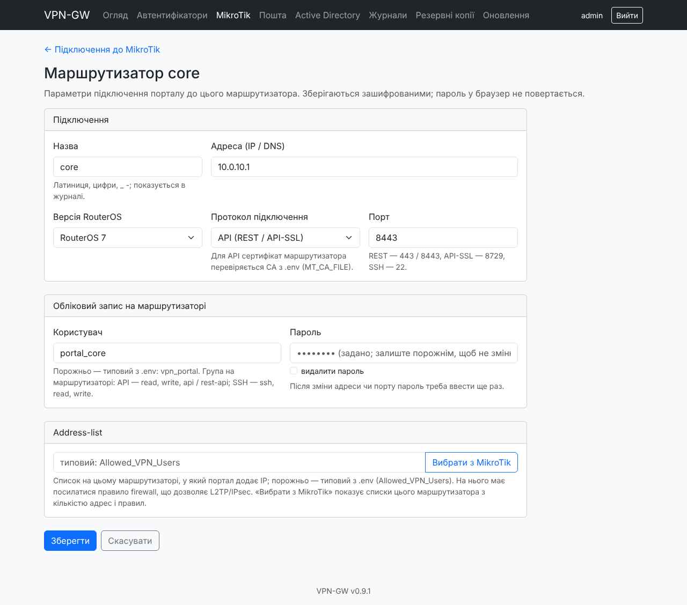

**«Зберегти»** (для нового — «Додати маршрутизатор») зберігає лише цей маршрутизатор і повертає до сторінки «Підключення до MikroTik»; «Скасувати» — без змін. Інші маршрутизатори не змінюються. До 8 маршрутизаторів.

**Видалити маршрутизатор:** у таблиці **«Підключені маршрутизатори»** натисніть «Видалити» в його рядку. Це єдиний спосіб видалення. Що відбувається:
- маршрутизатор одразу прибирається з налаштувань разом з його власним паролем і підтвердженим ключем SSH;
- адреси, які портал уже додав на цьому MikroTik, той видалить сам після тайм-ауту (або видаліть їх на маршрутизаторі вручну);
- підтвердження перед видаленням немає (панель без JavaScript); останній маршрутизатор видалити не можна — портал має працювати хоча б з одним;
- у журнал записується подія `admin_router_deleted` (хто, який маршрутизатор, адреса).

Таблиця показує **збережені** налаштування: назву, адресу й порт, версію, протокол, користувача (власний чи типовий, позначка «свій пароль»), address-list і стан ключа SSH.

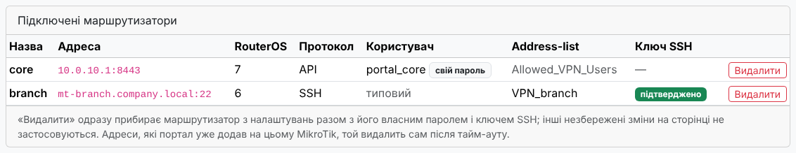

**Шифрування.** У базі зашифровані (`APP_KEY`, libsodium):
- список маршрутизаторів;
- логіни API і SSH (типові й власні логіни маршрутизаторів);
- паролі (типові й власні паролі маршрутизаторів);
- приватний ключ SSH і його пароль;
- збережені ключі хостів.

Паролі й приватний ключ у браузер не повертаються: поле лише перезаписується або очищається. Значення, задані в `.env`, зберігаються у файлі відкритим текстом, тож параметри підключення краще вводити в панелі.

### 4.1. Користувач і пароль маршрутизатора

Кожен маршрутизатор може мати власний обліковий запис. Це зручно, якщо на маршрутизаторах різні паролі або різні
імена користувачів, і безпечніше: компрометація пароля одного маршрутизатора не відкриває інші.

| Поле | Як працює |
|---|---|
| Користувач | Обліковий запис порталу на цьому маршрутизаторі. Лише латиниця, цифри, `.` `_` `@` `-`. Порожньо — типовий з `.env`, якщо він заданий (його ім'я видно сірим у порожньому полі) |
| Пароль | Якщо пароль задано, у полі видно «•••••••• (задано…)». Щоб не змінювати — залиште поле порожнім; щоб замінити — введіть новий; «видалити пароль» — прибрати власний пароль (тоді діє типовий з `.env`, якщо заданий) |

- Власний пароль у браузер не повертається і зберігається зашифрованим (`ROUTER_PASSWORDS`).
- Перейменування маршрутизатора пароль зберігає.
- Після зміни **адреси або порту** панель попросить ввести пароль ще раз. Так помилка в адресі не надішле пароль на чужий хост.
- Після змін натисніть «Перевірити MikroTik»: помилка входу показується окремо для кожного маршрутизатора.

На маршрутизаторі обліковий запис створюється так само, як типовий (`routeros7.rsc` / `routeros6.rsc` / `routeros-ssh.rsc`), лише з іншим ім'ям або паролем.

### 4.2. Ключ хоста SSH

Ключ хоста — це «відбиток» маршрутизатора. Перевірка ключа захищає від підміни сервера: якщо хтось перехопить адресу маршрутизатора, портал не надішле йому пароль.

1. Після додавання SSH-маршрутизатора на його картці і в таблиці стоїть **«ключ не підтверджено»**. Поки ключ не підтверджено, портал до цього маршрутизатора не підключається, а на огляді є попередження.
2. Натисніть **«Перевірити MikroTik»**. Панель підключиться, покаже відбиток `SHA256:…` і збереже його.
3. Звірте відбиток з адмінського ПК:
   ```bash
   ssh-keyscan -p 22 <адреса маршрутизатора> | ssh-keygen -lf -
   ```
   Відбиток з панелі має бути серед рядків, які виведе ця команда.

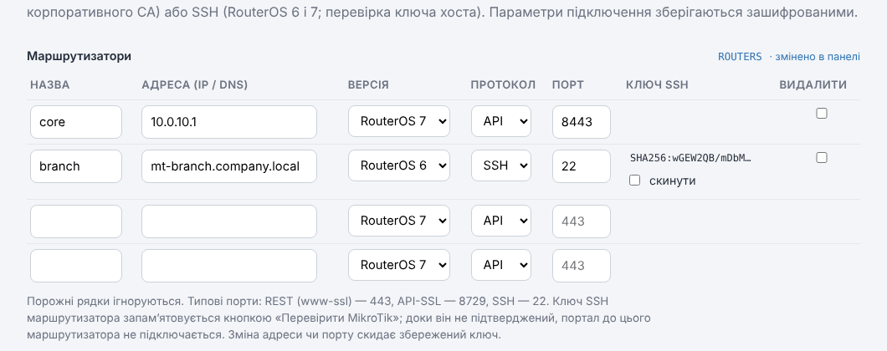

Якщо ключ маршрутизатора зміниться (заміна обладнання, перевстановлення RouterOS, скидання конфігурації), портал відмовить з повідомленням «SSH host key CHANGED». Що робити:
1. Переконайтеся, що маршрутизатор справді змінювали.
2. На сторінці маршрутизатора («Редагувати») позначте «скинути ключ» і натисніть «Зберегти».
3. Знову натисніть «Перевірити MikroTik».

Зміна адреси або порту маршрутизатора скидає збережений ключ автоматично.

### 4.3. Перевірка

**«Перевірити MikroTik»** підключається до кожного маршрутизатора зі **збереженими** налаштуваннями і читає його address-list (власний або типовий). Нічого не змінює.

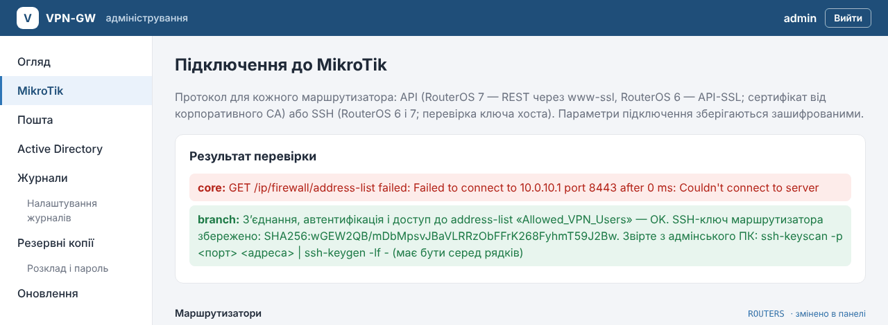

| Повідомлення | Причина |
|---|---|
| «Failed to connect …» / «Connection refused» / «SSH: cannot connect» | Сервіс вимкнено, інший порт, `address=` у `/ip service` без IP сервера, firewall |
| Помилка сертифіката (SSL) | Протокол API: сертифікат маршрутизатора виданий не тим CA, або в SAN немає адреси з поля «Адреса» |
| «401» / «invalid user name or password» / «SSH login failed» | Користувач, пароль або ключ саме цього маршрутизатора — «Редагувати» (4.1) |
| «not enough permissions» | Група користувача без потрібних прав: API — `read,write,api` / `rest-api`, SSH — `ssh,read,write` |
| «SSH host key CHANGED» | Див. 4.2 |
| «SSH: refused unsafe … value» | Значення з недопустимими символами; портал його не надсилає (захист від ін'єкції команд) |

### 4.4. Address-list для кожного маршрутизатора

На сторінці кожного маршрутизатора («Редагувати») є блок **«Address-list»** — список, у який портал додає IP саме на цьому маршрутизаторі. Порожньо — **типовий** список (`MT_LIST` у `.env`, типово `Allowed_VPN_Users`). Так можна, наприклад, на `core` використовувати `Allowed_VPN_Users`, а на `branch` — `VPN_branch`.

**Вибір зі списків, наявних на маршрутизаторах:**
1. На сторінці маршрутизатора натисніть **«Вибрати з MikroTik»** у блоці «Address-list». Портал прочитає списки маршрутизатора; на маршрутизаторі нічого не змінюється.
2. Поле стане списком вибору — лише зі списків **цього** маршрутизатора:
   - **адреси** — скільки записів зараз у списку;
   - **правила** — скільки правил firewall (`filter`, `nat`, `mangle`, `raw`) посилаються на список;
   - **«типовий: …»** — використовувати типовий список (з його станом на цьому маршрутизаторі або «на маршрутизаторі немає»);
   - **«інший / новий…»** — ввести назву в поле під списком.
3. Натисніть **«Зберегти»**. Без «Зберегти» вибір не застосовується.

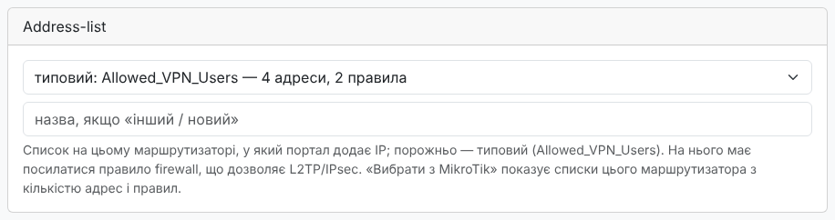

Як вибрати правильно:
- Потрібен список, на який посилається правило, що дозволяє L2TP/IPsec (`src-address-list=…`), на цьому маршрутизаторі. Список з «0 правил» нічого не відкриє.
- «0 адрес» — нормально: адреси з'являються після входу користувачів і зникають після тайм-ауту.
- Якщо власного списку маршрутизатора там уже немає, він лишається у виборі з позначкою «на маршрутизаторі не знайдено».
- Показуються лише назви з латиниці, цифр і `_` `.` `-`.
- Якщо маршрутизатор не вдалося прочитати, помилка показується вгорі сторінки, а поле лишається звичайним. SSH-маршрутизатор має мати підтверджений ключ (4.2).

### 4.5. Перевірка з сервера

Перевірка з додаванням тестової адреси — з сервера: `sudo -u vpngw php /srv/vpn-gw/bin/mt-check.php grant 198.51.100.99` (потім `revoke`).

### 4.6. Відключення маршрутизатора

**«Відключити»** на картці тимчасово виводить маршрутизатор з роботи, **не втрачаючи налаштувань**: адреса, протокол, користувач, власний пароль, address-list і підтверджений ключ SSH зберігаються. Поки маршрутизатор відключено, портал:
- не додає на ньому IP користувачів (доступ відкривається лише на активних маршрутизаторах);
- не видаляє на ньому адрес і не розриває сесій («Відключити» користувача на «Огляді»);
- не перевіряє його і не читає з нього address-list («Перевірити MikroTik», «Отримати списки з MikroTik»).

Коли це потрібно: маршрутизатор на обслуговуванні, оновлюється RouterOS, недоступний канал — щоб вхід користувачів не чекав на нього і не завершувався помилкою.

**«Включити»** повертає маршрутизатор у роботу з тими самими налаштуваннями. Сторінку відключеного маршрутизатора можна редагувати — він лишається відключеним.

Відключити або видалити **останній активний** маршрутизатор не можна: портал має працювати хоча б з одним (кнопки неактивні). Адреси, які портал уже додав на маршрутизаторі до відключення, MikroTik видалить сам після тайм-ауту. У журнал записуються події `admin_router_disabled` / `admin_router_enabled`. У `ROUTERS` відключений маршрутизатор має позначку `"disabled": true`.

---

## 5. Пошта

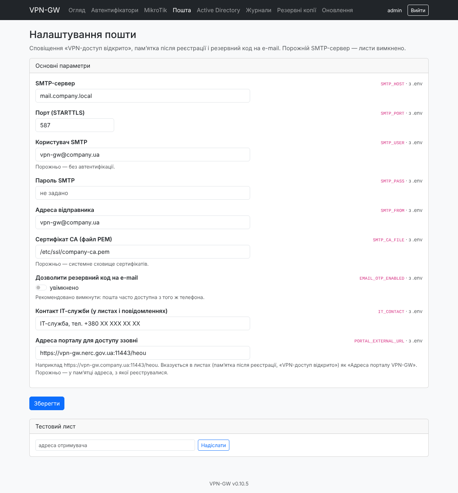

| Поле | Що вказати |
|---|---|
| SMTP-сервер, порт | Сервер з STARTTLS, зазвичай порт 587. Порожній сервер вимикає листи |
| Користувач / пароль SMTP | Якщо сервер вимагає автентифікації; порожній користувач — без неї |
| Адреса відправника | Наприклад, `vpn-gw@company.ua` |
| Сертифікат CA | Порожньо — системне сховище; для внутрішнього сервера — `/etc/ssl/company-ca.pem` |
| Резервний код на e-mail | Вмикайте, лише якщо пошта **не** доступна з Інтернету за доменним паролем, бо інакше другий фактор втрачає сенс |
| Контакт ІТ-служби | Показується користувачам у листах і повідомленнях |
| Адреса порталу для доступу ззовні | Повна адреса порталу з Інтернету, наприклад `https://vpn-gw.nerc.gov.ua:11443/heou`. У листі з пам'яткою і в листі «VPN-доступ відкрито» вказується як «Адреса порталу VPN-GW: …» — єдина адреса в листі. Лише `https://`, без логіна, параметрів і пробілів. Порожньо — у пам'ятці буде адреса, з якої користувач реєструвався, а лист «VPN-доступ відкрито» буде без адреси (`.env`: `PORTAL_EXTERNAL_URL`) |

**«Надіслати»** відправляє тестовий лист на вказану адресу. Помилка SMTP показується дослівно (наприклад, «Could not authenticate»).


### 5.1. Пам'ятка після реєстрації автентифікатора

Під час першої реєстрації Microsoft Authenticator користувач вказує **e-mail для пам'ятки** (типово підставляється його адреса з AD). Після успішної реєстрації:
- адреса зберігається в базі за його логіном (видно на сторінці «Автентифікатори»);
- на неї надсилається лист з PDF **«Як підключатися до робочого VPN»** — кроки з частини C інструкції користувача, адреса порталу: адреса для доступу ззовні (5), а якщо її не задано — та, з якої користувач реєструвався.

PDF лежить у папці документації порталу: `/srv/vpn-gw/doc/VPN-GW_Інструкція_підключення.pdf` (інший файл можна вказати в `.env`: `USER_GUIDE_PDF`). Якщо пошту не налаштовано, адресу все одно буде збережено, а користувач побачить, що лист не надіслано. Невдале надсилання реєстрацію не скасовує; помилка — у журналі (`mail_error`).

---

## 6. Active Directory

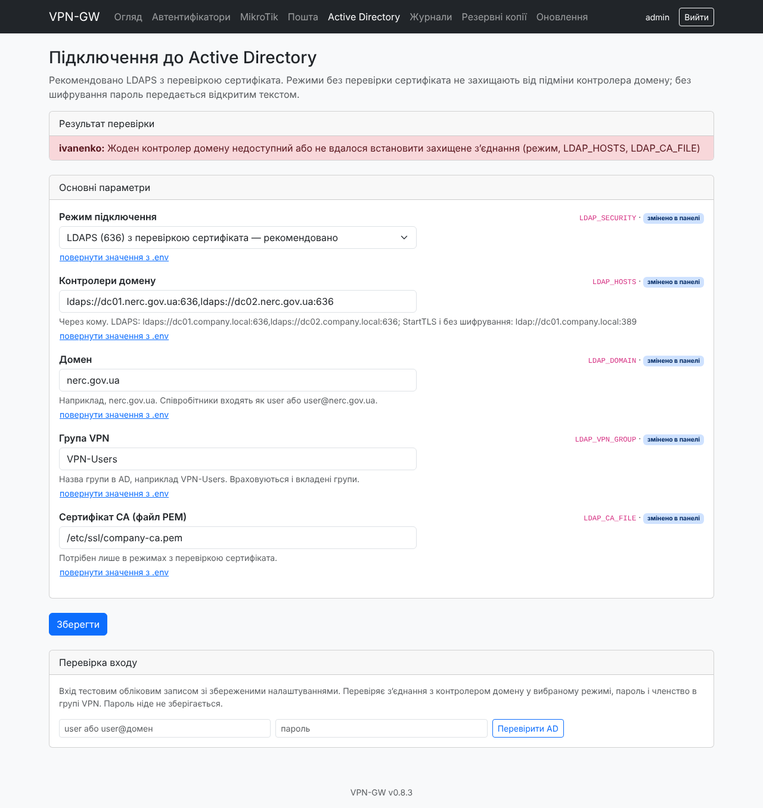

| Поле | Що вказати |
|---|---|
| Режим підключення | Див. таблицю нижче |
| Контролери домену | Через кому, перебираються по черзі. LDAPS: `ldaps://dc01.company.local:636,…`; StartTLS і без шифрування: `ldap://dc01.company.local:389,…` |
| Домен | `nerc.gov.ua`. Співробітники входять як `user` або `user@nerc.gov.ua`; логіни з іншим доменом відхиляються. База пошуку (`DC=nerc,DC=gov,DC=ua`) визначається з домену автоматично |
| Група VPN | Назва групи в AD, наприклад `VPN-Users` (за `sAMAccountName` або CN). Портал знаходить групу сам; враховуються вкладені групи. Для пілоту можна тимчасово вказати пілотну групу |
| Сертифікат CA | PEM корпоративного CA, яким підписані сертифікати DC. Потрібен лише в режимах з перевіркою сертифіката |

**Режими підключення:**

| Режим | Шифрування | Перевірка сертифіката DC | Коли використовувати |
|---|---|---|---|
| LDAPS з перевіркою (рекомендовано) | так | так | Завжди, коли є сертифікат DC від корпоративного CA |
| LDAPS без перевірки | так | ні | Тимчасово, поки немає CA-файла або в DC самопідписаний сертифікат |
| StartTLS з перевіркою | так | так | Якщо порт 636 закрито, а 389 відкрито |
| StartTLS без перевірки | так | ні | Як LDAPS без перевірки, але через порт 389 |
| LDAP без шифрування | ні | — | Лише для тестового стенда |

> Без перевірки сертифіката пароль шифрується, але немає захисту від підміни контролера домену: зловмисник у мережі між порталом і DC може видати себе за DC і отримати паролі. Без шифрування паролі передаються мережею відкритим текстом. Панель показує про це попередження на огляді, `install.sh` — у перевірках. Перейдіть на режим з перевіркою, щойно буде готовий сертифікат.

У режимах StartTLS портал ніколи не продовжує без шифрування: якщо StartTLS не вдався, він переходить до наступного DC.

**«Перевірити AD»** виконує вхід тестовим обліковим записом зі збереженими налаштуваннями. Пароль ніде не зберігається і в журнал не пишеться.

| Результат | Що означає |
|---|---|
| «Вхід успішний, користувач у групі VPN» | Усе налаштовано |
| «…логін або пароль неправильні» | З'єднання з DC працює; перевірте обліковий запис |
| «…вимкнено або він не в групі VPN» | Пароль правильний; перевірте членство в групі |
| «…групу VPN «…» не знайдено в домені» | Пароль правильний, але групи з такою назвою немає (або їх кілька); перевірте назву групи |
| «Жоден контролер домену недоступний або не вдалося встановити захищене з'єднання» | Адреси DC і схема (`ldaps://` / `ldap://`), порт, firewall, режим, файл CA |

Кожна перевірка — це справжній вхід в AD. Невдалі спроби враховуються лічильником блокування облікового запису в AD.

---

## 7. Журнали

### 7.1. Налаштування: куди і що писати

**Журнали → вкладка «Налаштування журналів».**


| Поле | Значення |
|---|---|
| Файл журналу | `/var/lib/vpn-gw/logs/audit.log` (типово) або файл `*.log` у `/var/log/vpn-gw/` |
| Зберігати, днів | Щоденна ротація зі стисненням; старіші файли видаляються. Агент оновлює `/etc/logrotate.d/vpn-gw` протягом години |
| Рівень | **info** — усі події; **warning** — лише невдачі та помилки |
| Що записувати | **Вхід**: пароль AD, другий фактор, блокування. **Доступ**: додавання і видалення IP на MikroTik. **Реєстрація** і скидання автентифікатора. **Листи**. Дії адміністраторів і системні події (помилки, резервні копії, оновлення) пишуться **завжди** |
| Локальний syslog, facility | Дублювання в rsyslog сервера (типово `local5`); далі rsyslog може пересилати в SIEM |
| Віддалений syslog / SIEM | `хост:порт` — пряме надсилання UDP (RFC 5424) без rsyslog. Недоступність SIEM не впливає на вхід користувачів |

Кожна подія — один JSON-рядок з полями:
- `event`, `category`;
- `user`, `ip`;
- `app_version`, адреса і браузер клієнта;
- деталі події.

Паролі, коди, токени й секрети не записуються ніколи: такі поля відкидаються автоматично.

### 7.2. Перегляд

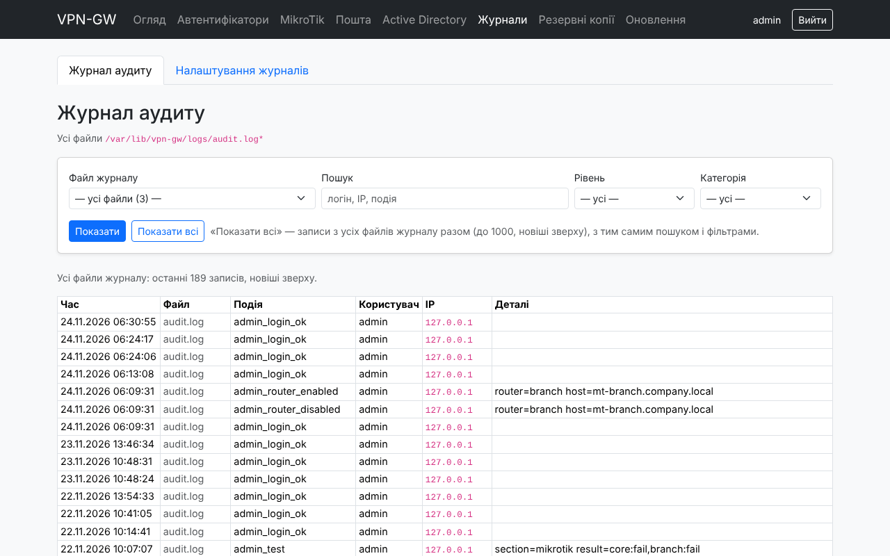

Показує останні 300 записів (новіші зверху) з пошуком за логіном, IP або подією, з фільтрами за рівнем і категорією. Подія показується звичайним текстом; рядки з рівнем warning підсвічені жовтим.

**Файл журналу.** Журнал щодня ротується (logrotate): поточний `audit.log`, вчорашній `audit.log.1`, старіші — стиснені `audit.log.2.gz`, `audit.log.3.gz`, … (зберігаються стільки днів, скільки задано в 7.1). У списку **«Файл журналу»** — усі ці файли з датою зміни й розміром: поточний першим, далі від новіших до старіших. Виберіть файл і натисніть «Показати» — пошук і фільтри діють у вибраному файлі; стиснені файли розпаковуються на льоту. У великому файлі переглядаються останні 8 МБ записів.

**«Показати всі»** — записи з усіх файлів журналу разом: поточного, далі ротованих від новіших до старіших; новіші зверху, до 1000 записів, з тим самим пошуком і фільтрами. У таблиці з'являється колонка «Файл» — з якого файлу запис. Те саме — пункт «усі файли» у списку «Файл журналу». Зручно, щоб знайти всі події користувача чи IP за кілька днів: введіть логін у «Пошук» і натисніть «Показати всі». Кнопка неактивна, поки ротованих файлів немає.

**«Завантажити»** (над формою) — вибраний файл як є (`.gz` — стисненим), наприклад, для передачі в SIEM чи розслідування. У журнал записується подія `admin_log_download`. Показуються й завантажуються лише файли журналу з каталогу `LOG_PATH` з його назвою — інших файлів панель не віддає.

| Подія | Що означає |
|---|---|
| `login_ok` / `login_fail` | Пароль AD прийнято / відхилено (у `reason` — причина) |
| `mfa_ok` / `mfa_fail` | Код автентифікатора прийнято / відхилено |
| `lockout`, `login_blocked` | Спрацювало блокування за IP або логіном |
| `mt_add`, `mt_update`, `mt_revoke` | Адресу додано / подовжено / видалено на маршрутизаторі |
| `mt_error` | Маршрутизатор не відповів або відмовив (у `router`, `error`) |
| `admin_revoke` | Адміністратор відключив користувача (у `target`, `client_ip`, `result`) |
| `admin_totp_reset` | Адміністратор видалив автентифікатор користувача (у `target`) |
| `enroll_email` | Користувач під час реєстрації вказав e-mail для пам'ятки (у `email`) |
| `admin_router_deleted` | Адміністратор видалив маршрутизатор (у `router`, `host`) |
| `admin_router_disabled` / `admin_router_enabled` | Адміністратор відключив / увімкнув маршрутизатор |
| `admin_log_download` | Адміністратор завантажив файл журналу (у `file`) |
| `enroll_ok`, `totp_reset` | Автентифікатор зареєстровано / скинуто |
| `admin_*` | Дії в панелі: вхід, збереження налаштувань, перевірки, завантаження копій, оновлення |
| `backup_ok` / `backup_error`, `update_ok` / `update_error` | Результати роботи агента |

---

## 8. Резервні копії

### 8.1. Розклад і пароль

**Резервні копії → вкладка «Розклад і пароль».**

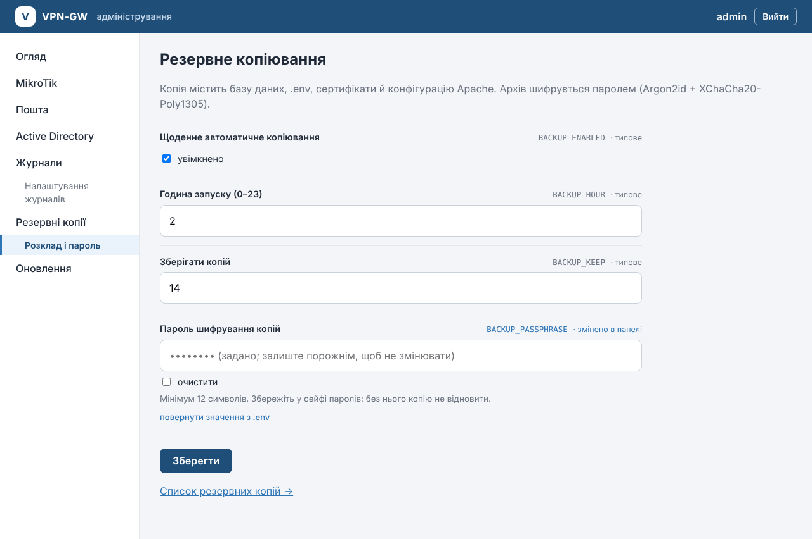

| Поле | Значення |
|---|---|
| Щоденне автоматичне копіювання | Увімкнено за замовчуванням |
| Година запуску | 0–23. Копія створюється в першу годинну перевірку після вказаної години, раз на добу |
| Зберігати копій | Старіші копії видаляються автоматично (усіх типів разом) |
| Пароль шифрування копій | Генерує `install.sh`. Мінімум 12 символів. **Без нього копію не відновити**: зберігайте в сейфі паролів окремо від копій |

### 8.2. Список і завантаження


Кожна копія — зашифрований файл `.vgbk` (Argon2id + XChaCha20-Poly1305). До складу входять:
- база даних: налаштування з панелі, адміністратори, зашифровані секрети TOTP;
- `.env` з ключами;
- `/etc/vpn-gw/install.conf`;
- TLS-сертифікати порталу і файли CA;
- конфігурація Apache, PHP-FPM, nftables і logrotate.

Типи копій: **за розкладом**, **вручну** (кнопка «Створити копію зараз») і **перед оновленням** (створюється автоматично).

**«Завантажити»** — зберегти копію поза сервером. Регулярно переносьте копії на захищене сховище: копія лише на тому самому сервері не допоможе, якщо сервер буде втрачено.

### 8.3. Відновлення

Відновлення виконується лише на сервері від root. Це свідомо: дія з найбільшими наслідками не повинна бути доступна з браузера.

```bash
sudo php /srv/vpn-gw/bin/restore.php /var/backups/vpn-gw/vpn-gw-20261115-020012-auto.vgbk          # показати вміст
sudo php /srv/vpn-gw/bin/restore.php /var/backups/vpn-gw/vpn-gw-20261115-020012-auto.vgbk --apply  # відновити
```
Скрипт запитує пароль копії і повертає файли зі списку в копії. Поточну базу він зберігає як `db.sqlite.before-restore-<час>`, потім перезапускає PHP-FPM і Apache.

**На новому сервері:**
1. Встановіть ту саму версію VPN-GW (`QUICKSTART.md`, кроки 1–5).
2. Скопіюйте `.vgbk` на сервер і виконайте `restore.php … --apply`.
3. Запустіть `install.sh --domain … --yes`.

---

## 9. Оновлення

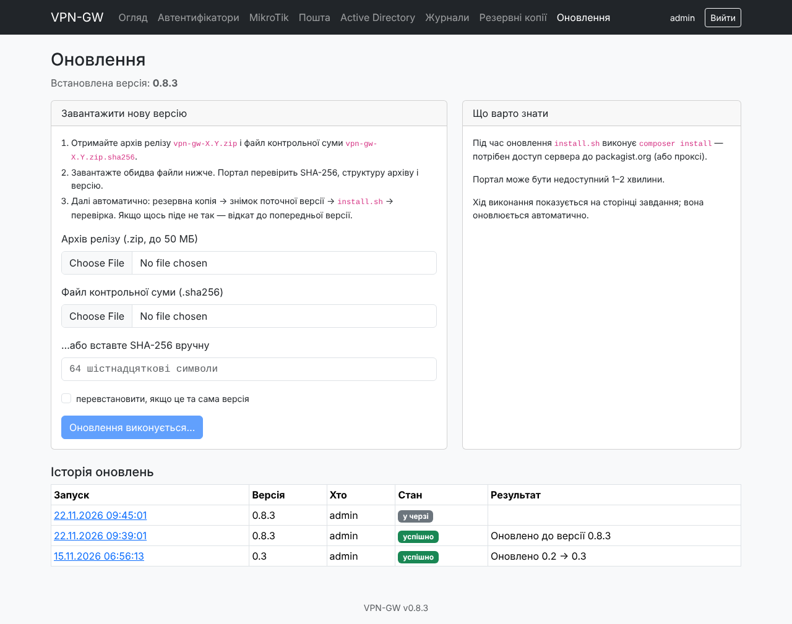

**Як оновити:**
1. Отримайте архів релізу `vpn-gw-X.Y.zip` і файл `vpn-gw-X.Y.zip.sha256`.
2. **Оновлення** → виберіть обидва файли (або вставте SHA-256 вручну) → **«Перевірити й оновити»**.
3. Відкриється сторінка завдання. Вона оновлюється кожні 5 секунд.


**Що відбувається:**

| Крок | Що перевіряється або робиться |
|---|---|
| 1. Портал | Ім'я `vpn-gw-X.Y.zip`, SHA-256, формат ZIP, версія новіша за встановлену (для повторного встановлення тієї самої версії — окремий прапорець). Розмір до 50 МБ |
| 2. Агент | Повторна перевірка SHA-256; структура архіву: один каталог `vpn-gw-X.Y`, без `..`, абсолютних шляхів і символьних посилань, розумний розмір після розпакування; файл `VERSION` |
| 3. Резервна копія | Копія типу «перед оновленням» |
| 4. Знімок | Копія поточного `/srv/vpn-gw` і конфігурації веб-сервера |
| 5. Встановлення | `install.sh --domain … --yes` нової версії (оновлює пакети, залежності Composer, схему БД, конфігурацію) |
| 6. Перевірка | Застосунок нової версії відповідає і бачить базу |
| 7. Відкат | Якщо крок 5 або 6 не вдався — повернення коду й конфігурації зі знімка, перезапуск PHP-FPM і Apache |

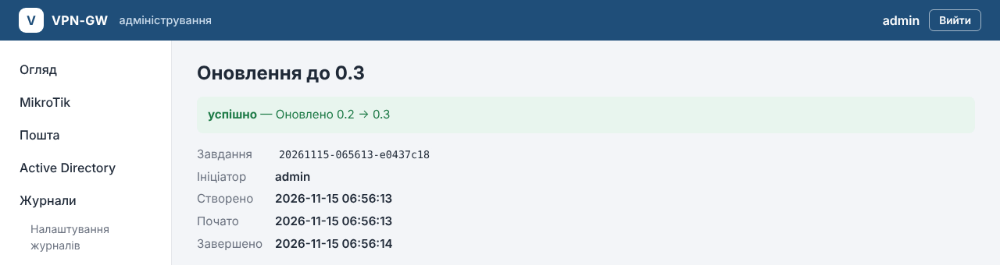

**Під час оновлення:**
- портал може бути недоступний 1–2 хвилини;
- серверу потрібен доступ до packagist.org (Composer);
- у журналі виконання на сторінці завдання видно вивід `install.sh`; рядки з маркерами підсвічуються: `[ OK ]` — зелений, `[WARN]` — жовтий, `[FAIL]` / `[FATAL]` — червоний.

Після відкату невдала версія лишається в `/srv/vpn-gw.failed-<id>` для аналізу; потім цей каталог можна видалити.

> **Безпека.** Оновлення через панель виконує код з архіву від імені root. SHA-256 захищає від пошкодженого або підміненого при передачі файлу, але не підтверджує, хто зібрав архів. Отримуйте релізи лише з довіреного джерела, порівнюйте контрольну суму з опублікованою окремо, а доступ до панелі надавайте лише тим, кому довірено root-доступ до сервера. Спершу оновлюйте тестовий стенд.

Оновлення з командного рядка залишається доступним (`QUICKSTART.md`, «Оновлення до нової версії»).

---

## 10. Як це влаштовано (коротко)

```
Браузер адміністратора ──HTTPS──► Apache ──► PHP-FPM (користувач vpngw)
                                               │  налаштування → SQLite (секрети зашифровані APP_KEY)
                                               │  завдання (копія, оновлення) → /var/lib/vpn-gw/spool
                                               ▼
                            systemd: vpn-gw-agent.path / .timer
                                               ▼
                            агент bin/agent.php (root): копії, оновлення, logrotate
                                               │  стан завдань → /var/lib/vpn-gw-agent/status
                                               └► копії → /var/backups/vpn-gw
```

- Веб-процес не може виконувати команди (`exec`, `proc_open` вимкнено в PHP-FPM). Привілейовані дії робить агент.
- Агент приймає лише два типи завдань і перевіряє їх як недовірені дані.
- Код у `/srv/vpn-gw` належить root: зламаний веб-процес не може змінити програму, яку запускає агент.
- Агент перевіряє розклад копій і налаштування ротації журналів щогодини (`vpn-gw-agent.timer`), а завдання з панелі виконує одразу.

**Діагностика агента:**
```bash
systemctl status vpn-gw-agent.path vpn-gw-agent.timer
journalctl -u vpn-gw-agent -n 50
sudo php /srv/vpn-gw/bin/agent.php run        # виконати чергу і перевірки вручну
```

---

## 11. Типові ситуації

| Ситуація | Що робити |
|---|---|
| Панель → 404 | Ваш ПК не в `INTERNAL_NETWORKS`. Додайте підмережу в `.env`, `install.sh --yes` |
| Вхід до панелі: «Забагато невдалих спроб» | Зачекайте `LOCKOUT_SECONDS` (типово 15 хв) або на сервері: `admin.php passwd <логін>` — знімає блокування логіна; `unlock.php --ip <адреса ПК> --by <хто>` — блокування адреси |
| Користувач бачить «Забагато спроб. Спробуйте пізніше.» | «Огляд» → «Активні блокування» → «Розблокувати» (2.3), або зачекайте 15 хв |
| Забули пароль | `sudo -u vpngw php /srv/vpn-gw/bin/admin.php passwd admin` |
| «Не збережено: …» | Виправте поле з повідомлення. Нічого не змінилося |
| Після збереження портал → 500 | `settings.php list`, потім `settings.php reset <KEY>` |
| Завдання «у черзі — очікує агента» | `systemctl status vpn-gw-agent.path`; якщо неактивний — `install.sh --yes` |
| Копія: «Не задано пароль шифрування» | **Резервні копії → Розклад і пароль** |
| Оновлення: «Контрольна сума … не збігається» | Файл пошкоджено або це інший файл. Завантажте архів і `.sha256` ще раз |
| Оновлення: «…виконано відкат» | Відкрийте журнал на сторінці завдання. Найчастіше `composer install` не має доступу до packagist.org |
| Співробітник звільнився (адміністратор) | `admin.php delete <логін>`; змініть пароль резервних копій і паролі сервісних облікових записів |
