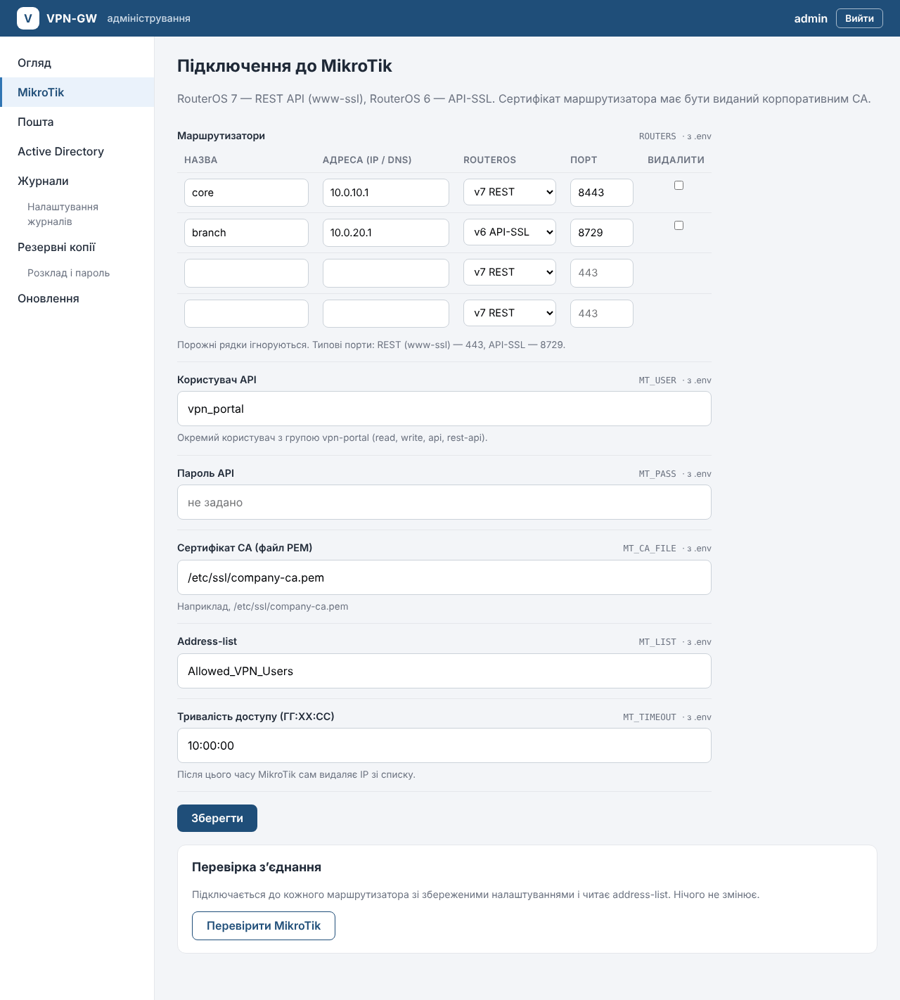
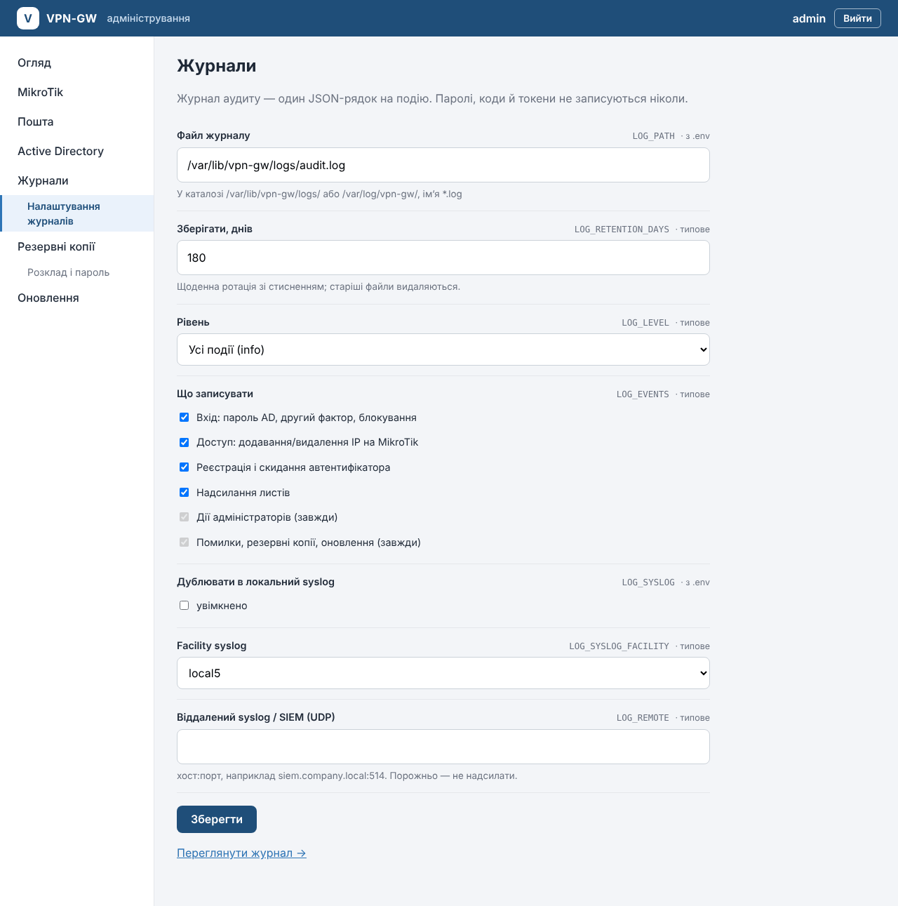
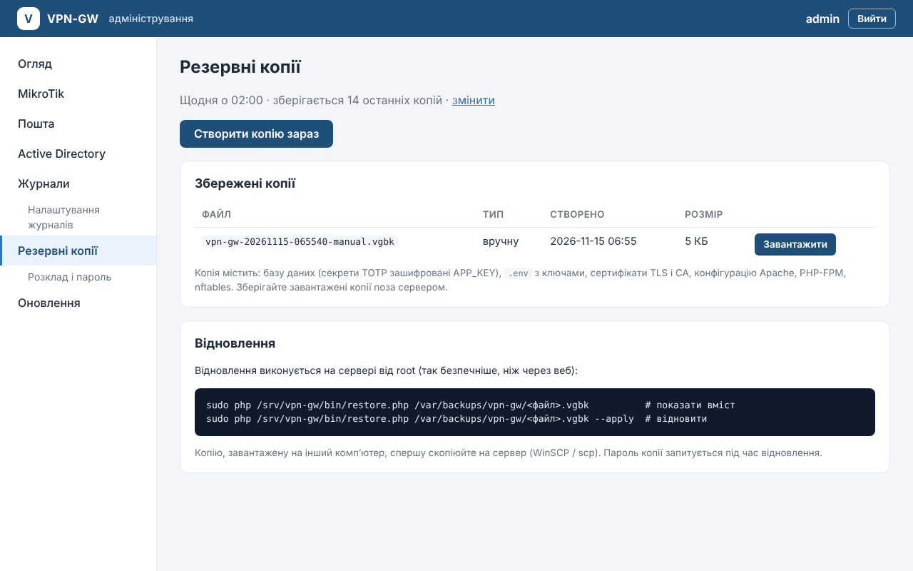
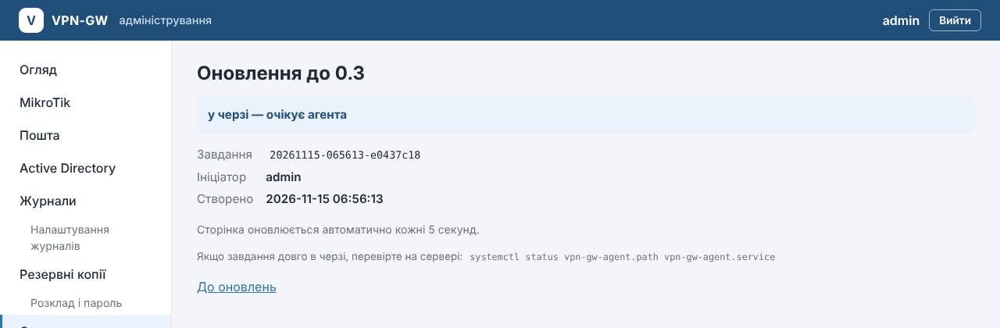

# VPN-GW: посібник адміністратора панелі

**VPN-GW 0.2 · 15.11.2026** · Для адміністраторів, які обслуговують портал. Встановлення сервера описано в `QUICKSTART.md` і `INSTALL_GUIDE.md`, будова коду — у `DEVELOPMENT.md`.

Панель адміністратора дає змогу без командного рядка:
- налаштовувати підключення до MikroTik, пошти й Active Directory і перевіряти їх кнопкою;
- вибирати, куди і що писати в журнал, і переглядати журнал;
- створювати й завантажувати резервні копії;
- оновлювати портал завантаженням архіву нової версії.

---

## 1. Вхід

**Адреса:** `https://vpn-gw.company.ua/<APP_BASE_PATH>/admin`. Шлях `APP_BASE_PATH` той самий, що й у порталу; його видно в `/srv/vpn-gw/.env`.


| Правило | Пояснення |
|---|---|
| Лише з внутрішньої мережі | Панель відкривається тільки з підмереж `INTERNAL_NETWORKS` у `.env`. З Інтернету будь-яка адреса `/admin…` повертає 404, ніби її не існує |
| Локальні облікові записи | Адміністратори панелі не залежать від AD: панель працює, навіть коли налаштування AD хибні. Пароль — мінімум 12 символів, зберігається як хеш Argon2id |
| Ліміт спроб | 5 невдалих входів з однієї адреси або для одного логіна блокують вхід на `LOCKOUT_SECONDS` (типово 15 хв) |
| Сесія | Прив'язана до IP-адреси. Завершується після 30 хв бездіяльності, але не пізніше ніж через 8 год |

Перший обліковий запис (`admin`) створює `install.sh`. Інші — з командного рядка сервера:

```bash
sudo -u vpngw php /srv/vpn-gw/bin/admin.php list              # перелік
sudo -u vpngw php /srv/vpn-gw/bin/admin.php create petrenko   # новий адміністратор (пароль запитується)
sudo -u vpngw php /srv/vpn-gw/bin/admin.php passwd admin      # новий пароль, якщо забули
sudo -u vpngw php /srv/vpn-gw/bin/admin.php delete petrenko   # видалити
```
Свій пароль можна змінити в панелі: клацніть своє ім'я праворуч угорі.

---

## 2. Огляд


**Плитки:**
- кількість активних доступів;
- кількість зареєстрованих автентифікаторів;
- кількість маршрутизаторів;
- версія VPN-GW.

**Нижче:**
- поточні підключення: MikroTik, AD, пошта, файл журналу, остання резервна копія;
- параметри, які змінюються лише в `.env`;
- останні видачі доступу;
- останні завдання (резервні копії, оновлення).

Попередження вгорі з'являються, якщо:
- не задано пароль резервних копій;
- вимкнено пошту;
- остання копія старша за дві доби.

---

## 3. Як працюють налаштування

- Значення з панелі мають **пріоритет** над `.env`. Біля кожного поля видно назву параметра і джерело: «з .env», «змінено в панелі» або «типове».
- **Перед збереженням перевіряється вся конфігурація.** Якщо значення хибне, з'являється «Не збережено: …», а попереднє значення залишається. Портал продовжує працювати.
- **Паролі** (MikroTik, SMTP, резервні копії) зберігаються зашифрованими і в браузер не повертаються. Щоб залишити пароль без змін, не заповнюйте поле. Щоб видалити — позначте «очистити».
- Поле, змінене в панелі, має посилання **«повернути значення з .env»**.
- Нові значення діють з наступного запиту. Перезапускати нічого не потрібно.
- Кожне збереження записується в журнал (подія `admin_settings_saved`): хто зберіг і які параметри змінено, без значень.

Деякі параметри змінюються **лише в `.env`**: від них залежить доступ до самої панелі або захист порталу. Це `APP_BASE_PATH`, `APP_KEY`, `INTERNAL_NETWORKS`, `TRUSTED_PROXIES`, ліміти `RATE_*`, `LOCKOUT_SECONDS` і шляхи до бази. Після зміни `.env` запустіть `install.sh --yes`.

**Аварійне скидання.** Якщо значення з панелі пройшло перевірку, але заважає порталу працювати в цьому середовищі:
```bash
sudo -u vpngw php /srv/vpn-gw/bin/settings.php list           # чинні значення і джерело
sudo -u vpngw php /srv/vpn-gw/bin/settings.php reset SMTP_HOST
```

---

## 4. MikroTik



| Поле | Що вказати |
|---|---|
| Маршрутизатори | Назва (латиниця, цифри, `_` `-`, відображається в журналі), адреса (IP або DNS-ім'я з сертифіката), **v7 REST** або **v6 API-SSL**, порт сервісу (`www-ssl` / `api-ssl`). Два порожні рядки — для нових маршрутизаторів; «Видалити» — прибрати. До 8 маршрутизаторів |
| Користувач API / Пароль API | Обліковий запис `vpn_portal` з `deploy/mikrotik/routeros*.rsc` |
| Сертифікат CA | PEM-файл корпоративного CA у `/etc/ssl/` (напр. `/etc/ssl/company-ca.pem`) |
| Address-list | Список, у який портал додає IP (типово `Allowed_VPN_Users`); має збігатися з правилами firewall на маршрутизаторах |
| Тривалість доступу | `ГГ:ХХ:СС`; після цього MikroTik сам видаляє адресу |

**«Перевірити MikroTik»** підключається до кожного маршрутизатора зі **збереженими** налаштуваннями і читає address-list. Нічого не змінює.


| Повідомлення | Причина |
|---|---|
| «Failed to connect …» / «Connection refused» | Сервіс вимкнено, інший порт, `address=` у `/ip service` без IP сервера, firewall |
| Помилка сертифіката (SSL) | Сертифікат маршрутизатора виданий не тим CA, або в SAN немає адреси з поля «Адреса» |
| «401» / «invalid user name or password» | Користувач або пароль API |
| «not enough permissions» | Група користувача без `read,write,api` / `rest-api` |

Перевірка з додаванням тестової адреси — з сервера: `sudo -u vpngw php /srv/vpn-gw/bin/mt-check.php grant 198.51.100.99` (потім `revoke`).

---

## 5. Пошта


| Поле | Що вказати |
|---|---|
| SMTP-сервер, порт | Сервер з STARTTLS, зазвичай порт 587. Порожній сервер вимикає листи |
| Користувач / пароль SMTP | Якщо сервер вимагає автентифікації; порожній користувач — без неї |
| Адреса відправника | Наприклад, `vpn-gw@company.ua` |
| Сертифікат CA | Порожньо — системне сховище; для внутрішнього сервера — `/etc/ssl/company-ca.pem` |
| Резервний код на e-mail | Вмикайте, лише якщо пошта **не** доступна з Інтернету за доменним паролем, бо інакше другий фактор втрачає сенс |
| Контакт ІТ-служби | Показується користувачам у листах і повідомленнях |

**«Надіслати»** відправляє тестовий лист на вказану адресу. Помилка SMTP показується дослівно (наприклад, «Could not authenticate»).

---

## 6. Active Directory


| Поле | Що вказати |
|---|---|
| Контролери домену | `ldaps://dc01.company.local:636,ldaps://dc02.company.local:636`; лише LDAPS, перебираються по черзі |
| Суфікс UPN | `@company.local`; користувач вводить логін без домену |
| Base DN | `DC=company,DC=local` |
| DN групи VPN | `CN=VPN-Users,OU=Groups,DC=company,DC=local`; враховуються вкладені групи. Для пілоту можна тимчасово вказати пілотну групу |
| Сертифікат CA | PEM корпоративного CA, яким підписані сертифікати DC |

**«Перевірити AD»** виконує вхід тестовим обліковим записом зі збереженими налаштуваннями. Пароль ніде не зберігається і в журнал не пишеться.

| Результат | Що означає |
|---|---|
| «Вхід успішний, користувач у групі VPN» | Усе налаштовано |
| «…логін або пароль неправильні» | LDAPS і сертифікат працюють; перевірте обліковий запис |
| «…вимкнено або він не в групі VPN» | Пароль правильний; перевірте членство в групі (DN групи) |
| «Жоден контролер домену недоступний або сертифікат не довірений» | Адреси DC, порт 636, firewall, файл CA |

Кожна перевірка — це справжній вхід в AD. Невдалі спроби враховуються лічильником блокування облікового запису в AD.

---

## 7. Журнали

### 7.1. Налаштування: куди і що писати



| Поле | Значення |
|---|---|
| Файл журналу | `/var/lib/vpn-gw/logs/audit.log` (типово) або файл `*.log` у `/var/log/vpn-gw/` |
| Зберігати, днів | Щоденна ротація зі стисненням; старіші файли видаляються. Агент оновлює `/etc/logrotate.d/vpn-gw` протягом години |
| Рівень | **info** — усі події; **warning** — лише невдачі та помилки |
| Що записувати | **Вхід**: пароль AD, другий фактор, блокування. **Доступ**: додавання і видалення IP на MikroTik. **Реєстрація** і скидання автентифікатора. **Листи**. Дії адміністраторів і системні події (помилки, резервні копії, оновлення) пишуться **завжди** |
| Локальний syslog, facility | Дублювання в rsyslog сервера (типово `local5`); далі rsyslog може пересилати в SIEM |
| Віддалений syslog / SIEM | `хост:порт` — пряме надсилання UDP (RFC 5424) без rsyslog. Недоступність SIEM не впливає на вхід користувачів |

Кожна подія — один JSON-рядок з полями:
- `event`, `category`;
- `user`, `ip`;
- `app_version`, адреса і браузер клієнта;
- деталі події.

Паролі, коди, токени й секрети не записуються ніколи: такі поля відкидаються автоматично.

### 7.2. Перегляд


Показує останні 300 записів (новіші зверху) з пошуком за логіном, IP або подією, з фільтрами за рівнем і категорією. Попередження підсвічені.

| Подія | Що означає |
|---|---|
| `login_ok` / `login_fail` | Пароль AD прийнято / відхилено (у `reason` — причина) |
| `mfa_ok` / `mfa_fail` | Код автентифікатора прийнято / відхилено |
| `lockout`, `login_blocked` | Спрацювало блокування за IP або логіном |
| `mt_add`, `mt_update`, `mt_revoke` | Адресу додано / подовжено / видалено на маршрутизаторі |
| `mt_error` | Маршрутизатор не відповів або відмовив (у `router`, `error`) |
| `enroll_ok`, `totp_reset` | Автентифікатор зареєстровано / скинуто |
| `admin_*` | Дії в панелі: вхід, збереження налаштувань, перевірки, завантаження копій, оновлення |
| `backup_ok` / `backup_error`, `update_ok` / `update_error` | Результати роботи агента |

---

## 8. Резервні копії

### 8.1. Розклад і пароль


| Поле | Значення |
|---|---|
| Щоденне автоматичне копіювання | Увімкнено за замовчуванням |
| Година запуску | 0–23. Копія створюється в першу годинну перевірку після вказаної години, раз на добу |
| Зберігати копій | Старіші копії видаляються автоматично (усіх типів разом) |
| Пароль шифрування копій | Генерує `install.sh`. Мінімум 12 символів. **Без нього копію не відновити**: зберігайте в сейфі паролів окремо від копій |

### 8.2. Список і завантаження



Кожна копія — зашифрований файл `.vgbk` (Argon2id + XChaCha20-Poly1305). До складу входять:
- база даних: налаштування з панелі, адміністратори, зашифровані секрети TOTP;
- `.env` з ключами;
- `/etc/vpn-gw/install.conf`;
- TLS-сертифікати порталу і файли CA;
- конфігурація Apache, PHP-FPM, nftables і logrotate.

Типи копій: **за розкладом**, **вручну** (кнопка «Створити копію зараз») і **перед оновленням** (створюється автоматично).

**«Завантажити»** — зберегти копію поза сервером. Регулярно переносьте копії на захищене сховище: копія лише на тому самому сервері не допоможе, якщо сервер буде втрачено.

### 8.3. Відновлення

Відновлення виконується лише на сервері від root. Це свідомо: дія з найбільшими наслідками не повинна бути доступна з браузера.

```bash
sudo php /srv/vpn-gw/bin/restore.php /var/backups/vpn-gw/vpn-gw-20261115-020012-auto.vgbk          # показати вміст
sudo php /srv/vpn-gw/bin/restore.php /var/backups/vpn-gw/vpn-gw-20261115-020012-auto.vgbk --apply  # відновити
```
Скрипт запитує пароль копії і повертає файли зі списку в копії. Поточну базу він зберігає як `db.sqlite.before-restore-<час>`, потім перезапускає PHP-FPM і Apache.

**На новому сервері:**
1. Встановіть ту саму версію VPN-GW (`QUICKSTART.md`, кроки 1–5).
2. Скопіюйте `.vgbk` на сервер і виконайте `restore.php … --apply`.
3. Запустіть `install.sh --domain … --yes`.

---

## 9. Оновлення


**Як оновити:**
1. Отримайте архів релізу `vpn-gw-X.Y.zip` і файл `vpn-gw-X.Y.zip.sha256`.
2. **Оновлення** → виберіть обидва файли (або вставте SHA-256 вручну) → **«Перевірити й оновити»**.
3. Відкриється сторінка завдання. Вона оновлюється кожні 5 секунд.



**Що відбувається:**

| Крок | Що перевіряється або робиться |
|---|---|
| 1. Портал | Ім'я `vpn-gw-X.Y.zip`, SHA-256, формат ZIP, версія новіша за встановлену (для повторного встановлення тієї самої версії — окремий прапорець). Розмір до 50 МБ |
| 2. Агент | Повторна перевірка SHA-256; структура архіву: один каталог `vpn-gw-X.Y`, без `..`, абсолютних шляхів і символьних посилань, розумний розмір після розпакування; файл `VERSION` |
| 3. Резервна копія | Копія типу «перед оновленням» |
| 4. Знімок | Копія поточного `/srv/vpn-gw` і конфігурації веб-сервера |
| 5. Встановлення | `install.sh --domain … --yes` нової версії (оновлює пакети, залежності Composer, схему БД, конфігурацію) |
| 6. Перевірка | Застосунок нової версії відповідає і бачить базу |
| 7. Відкат | Якщо крок 5 або 6 не вдався — повернення коду й конфігурації зі знімка, перезапуск PHP-FPM і Apache |


**Під час оновлення:**
- портал може бути недоступний 1–2 хвилини;
- серверу потрібен доступ до packagist.org (Composer);
- у журналі виконання на сторінці завдання видно вивід `install.sh`.

Після відкату невдала версія лишається в `/srv/vpn-gw.failed-<id>` для аналізу; потім цей каталог можна видалити.

> **Безпека.** Оновлення через панель виконує код з архіву від імені root. SHA-256 захищає від пошкодженого або підміненого при передачі файлу, але не підтверджує, хто зібрав архів. Отримуйте релізи лише з довіреного джерела, порівнюйте контрольну суму з опублікованою окремо, а доступ до панелі надавайте лише тим, кому довірено root-доступ до сервера. Спершу оновлюйте тестовий стенд.

Оновлення з командного рядка залишається доступним (`QUICKSTART.md`, «Оновлення до нової версії»).

---

## 10. Як це влаштовано (коротко)

```
Браузер адміністратора ──HTTPS──► Apache ──► PHP-FPM (користувач vpngw)
                                               │  налаштування → SQLite (секрети зашифровані APP_KEY)
                                               │  завдання (копія, оновлення) → /var/lib/vpn-gw/spool
                                               ▼
                            systemd: vpn-gw-agent.path / .timer
                                               ▼
                            агент bin/agent.php (root): копії, оновлення, logrotate
                                               │  стан завдань → /var/lib/vpn-gw-agent/status
                                               └► копії → /var/backups/vpn-gw
```

- Веб-процес не може виконувати команди (`exec`, `proc_open` вимкнено в PHP-FPM). Привілейовані дії робить агент.
- Агент приймає лише два типи завдань і перевіряє їх як недовірені дані.
- Код у `/srv/vpn-gw` належить root: зламаний веб-процес не може змінити програму, яку запускає агент.
- Агент перевіряє розклад копій і налаштування ротації журналів щогодини (`vpn-gw-agent.timer`), а завдання з панелі виконує одразу.

**Діагностика агента:**
```bash
systemctl status vpn-gw-agent.path vpn-gw-agent.timer
journalctl -u vpn-gw-agent -n 50
sudo php /srv/vpn-gw/bin/agent.php run        # виконати чергу і перевірки вручну
```

---

## 11. Типові ситуації

| Ситуація | Що робити |
|---|---|
| Панель → 404 | Ваш ПК не в `INTERNAL_NETWORKS`. Додайте підмережу в `.env`, `install.sh --yes` |
| «Забагато невдалих спроб» | Зачекайте `LOCKOUT_SECONDS` (типово 15 хв) або на сервері: `admin.php passwd <логін>` — знімає блокування логіна; `unlock.php --ip <адреса ПК> --by <хто>` — блокування адреси |
| Забули пароль | `sudo -u vpngw php /srv/vpn-gw/bin/admin.php passwd admin` |
| «Не збережено: …» | Виправте поле з повідомлення. Нічого не змінилося |
| Після збереження портал → 500 | `settings.php list`, потім `settings.php reset <KEY>` |
| Завдання «у черзі — очікує агента» | `systemctl status vpn-gw-agent.path`; якщо неактивний — `install.sh --yes` |
| Копія: «Не задано пароль шифрування» | **Резервні копії → Розклад і пароль** |
| Оновлення: «Контрольна сума … не збігається» | Файл пошкоджено або це інший файл. Завантажте архів і `.sha256` ще раз |
| Оновлення: «…виконано відкат» | Відкрийте журнал на сторінці завдання. Найчастіше `composer install` не має доступу до packagist.org |
| Співробітник звільнився (адміністратор) | `admin.php delete <логін>`; змініть пароль резервних копій і паролі сервісних облікових записів |
